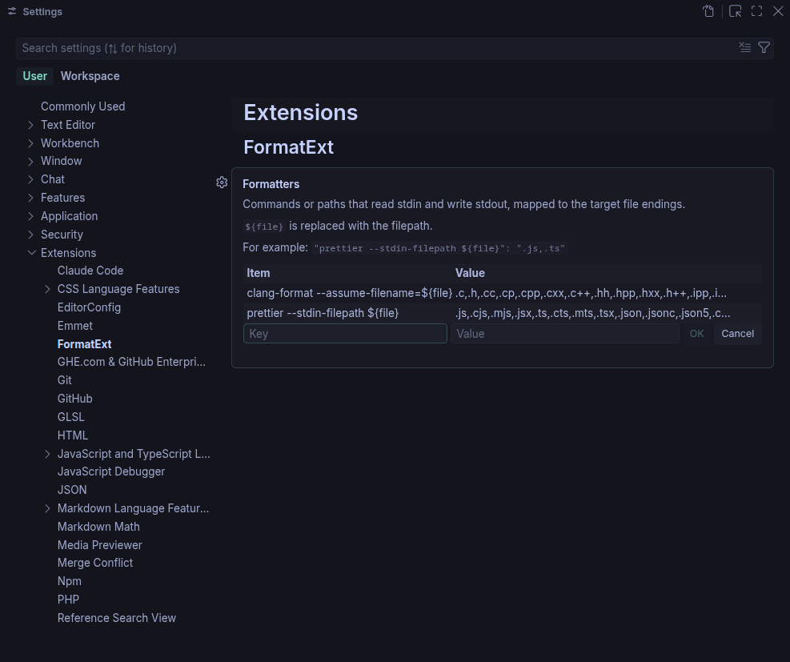

# FormatExt for VS Code

Point to your custom formatter without installing a bunch of VS Code extensions.

Set your paths and target extensions in Settings.



Settings (JSON):

```json
"formatExt.formatters": {
  "prettier --stdin-filepath ${file}": ".js,.ts"
}
```

Also recommended:

```json
  "editor.formatOnSave": true
```

## Side Notes

- Ensure `editor.defaultFormatter` is set to `1hue.format-ext`.

- Formatting is off in Restricted Mode.

- For logs and errors check the VS Code's Output panel (FormatExt).

- Works well with containerised [1hue/devtools](https://github.com/1hue/devtools).

